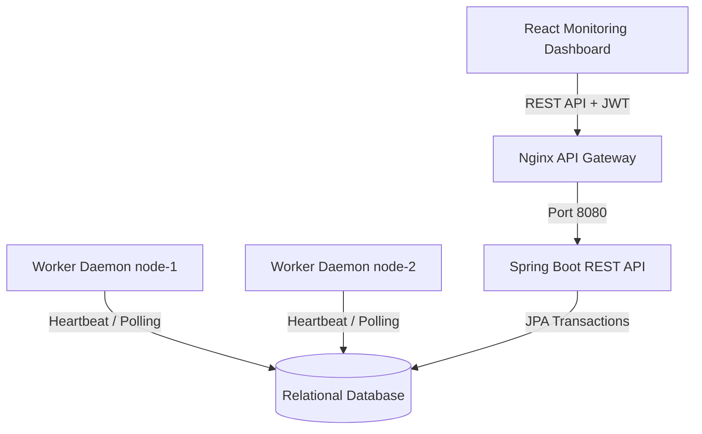

# Enterprise Distributed Job Scheduler

A production-grade, highly available **Distributed Job Scheduler** and execution platform designed to handle multi-tenant background work queues, atomic job claiming, resilient retry policies, and worker telemetry. 

Built with Java 21, Spring Boot, React, and a transactional relational database schema, this platform ensures exactly-once-inspired execution guarantees using atomic lock queries and provides real-time system monitoring.

---

## 🛠️ Technology Stack

* **Backend API:** Java 21, Spring Boot 3.2.4, Spring Security, JWT, Spring Data JPA (Hibernate), Maven 3.9
* **Worker Daemon:** Java 21, Spring Boot, Concurrent Executor Thread Pools, Telemetry Publisher
* **Database:** MySQL 8.0 / PostgreSQL 16 (for queues, registry, executions, and telemetry)
* **Frontend Dashboard:** React 18, Vite, Tailwind CSS, Recharts (analytics), Axios, Lucide Icons
* **Orchestration & Gateway:** Docker, Docker Compose, Nginx

---

## 🏗️ System Architecture

The architecture consists of three main decoupled layers: the user-facing Dashboard, the stateless REST API Gatekeeper, and the worker execution daemon pool.



### Core Architecture Highlights
1. **Atomic Job Claiming:** Workers retrieve available jobs using a database-backed queue polling mechanism powered by transactional `SELECT FOR UPDATE SKIP LOCKED` queries, preventing race conditions and double-execution of jobs.
2. **Resilient Retry Backoffs:** Built-in calculation engine supporting **Fixed Delay**, **Linear Backoff**, and **Exponential Backoff** options with automatic Dead Letter Queue (DLQ) containment on permanent failure.
3. **Graceful Shutdown:** Worker daemons monitor OS signals and wait for active thread pool executions to terminate before shutting down, protecting in-progress transactions.

---

## 📂 Project Structure

```text
distributed-job-scheduler/
├── backend-api/             # Spring Boot REST Server (Security, Controller APIs, Stats)
│   ├── src/main/java/       # Business logic, Controllers, DTOs, Security filters
│   └── src/main/resources/  # application.yml Configuration
├── worker-service/          # Headless Job Execution Daemon Module
│   ├── src/main/java/       # Database polling loop, claim transactions, execution runners
│   └── src/main/resources/  # application.yml Configuration
├── shared-core/             # Shared JPA Entities, Enums, and Repository definitions
│   └── src/main/java/       # Core domain mappings (Jobs, Queues, Workers, Logs)
├── frontend/                # React Dashboard SPA (UI layout, status tracking)
│   ├── src/pages/           # Login, Queues, Jobs, Workers, DLQ, Metrics components
│   └── tailwind.config.js   # Tailored layout configuration
├── database/                # Schema definitions
│   └── schema.sql           # Database tables and index configurations
├── docker/                  # Environment containment configurations
│   ├── backend.Dockerfile
│   ├── worker.Dockerfile
│   ├── frontend.Dockerfile
│   └── nginx.conf           # Gateway router and client SPA fallback gateway
├── docker-compose.yml       # Production Orchestration stack
├── pom.xml                  # Parent Maven project orchestrating all modules
└── README.md                # General system documentation
```

---

## 🚀 Setup & Execution Guide

### Prerequisite Components
- **Java Development Kit (JDK) 21**
- **Maven 3.9+**
- **Node.js 18+** & **npm**
- **Docker & Docker Compose**

---

### Run Using Docker Compose (Recommended)
This launches the entire stack (Database, Backend API, Worker Daemon, Frontend Dashboard, and Nginx Gateway) instantly.

```bash
# Build the project artifacts and spin up the Docker network
docker-compose up --build
```

#### Service URLs Post-Boot:
- **React Dashboard UI:** [http://localhost:3000](http://localhost:3000)
- **Spring Boot REST Engine Base Path:** `http://localhost:8080/api`
- **Swagger Documentation:** `http://localhost:8080/swagger-ui.html`

---

### Run Locally (For Development)

#### 1. Setup the Database
Create a database named `scheduler_db` on your local MySQL / PostgreSQL server. If using the custom MySQL setup configured during verification:
- Port: `3307`
- Username: `root`
- Password: *(empty)*

Run the SQL script `database/schema.sql` (if PostgreSQL) or let Hibernate's `ddl-auto: update` dynamically create and index the database tables on startup.

#### 2. Build and Register Modules
Install all shared modules into your local Maven cache:
```bash
mvn clean install -DskipTests
```

#### 3. Start the Backend API
```bash
cd backend-api
mvn spring-boot:run
```
The REST engine will bootstrap on port `8080`.

#### 4. Start the Worker Service Daemon
```bash
cd worker-service
mvn spring-boot:run
```
The daemon starts on port `8081`, registers as an active worker, and begins polling.

#### 5. Start the React Frontend
```bash
cd frontend
npm install
npm run dev
```
Open [http://localhost:5173](http://localhost:5173) in your browser.

---

## 🔑 REST API Guide

### 1. Authentication
* **Sign Up:** `POST /api/auth/signup`
  ```json
  {
    "username": "admin",
    "password": "password123",
    "role": "ROLE_ADMIN"
  }
  ```
* **Sign In:** `POST /api/auth/signin` -> Returns JWT token used in headers as `Authorization: Bearer <token>`.

### 2. Queue Management
* **Create Queue:** `POST /api/queues`
  ```json
  {
    "name": "critical-notifications",
    "projectId": "PROJ-UUID",
    "priority": 10,
    "maxConcurrency": 5
  }
  ```
* **Pause Queue:** `PUT /api/queues/{id}/pause`
* **Resume Queue:** `PUT /api/queues/{id}/resume`

### 3. Job Submission
* **Immediate Job:** `POST /api/jobs`
  ```json
  {
    "name": "send-welcome-email",
    "queueId": "QUEUE-UUID",
    "payload": "{\"userId\": \"1234\", \"duration\": 1000}",
    "priority": 5
  }
  ```
* **Delayed Job:** `POST /api/jobs` (add `delaySeconds` to defer execution)
* **Recurring Cron Job:** `POST /api/jobs` (uses standard CRON expression, e.g. `0 0 2 * * *`)

---

## 🔒 Security Architecture
1. **Stateless Sessions:** Leverages Spring Security configured with stateless JWT filters.
2. **Password Cryptography:** Salting and hashing credentials using BCrypt (strength factor 10).
3. **Queue Isolation:** Resource requests validate organization and project memberships to block illegal access.

---

## 📊 Dashboard Visuals

Here are some glimpses of the premium React monitoring dashboard:

1. **User Authentication Portal**
   Secure login and sign-up with dynamic blur gradients and glassmorphism.
2. **Worker Nodes Telemetry**
   Live monitoring page showing worker CPU/Memory usage, heartbeat timestamps, and active task volumes.
3. **Interactive Analytics**
   Throughput trends and queue limit comparisons mapped dynamically via responsive charts.

---

## 🔮 Future Improvements
- **Distributed Caching:** Integrate Redis for rate limiting and rapid job-status queries.
- **Distributed Locking:** Add Redisson-based locks for cross-node synchronization on shared queues.
- **Queue Sharding:** Partition large queues to increase scalability across multiple datacenters.
- **Real-Time Pushing:** Use WebSockets or Server-Sent Events (SSE) to update the dashboard dynamically instead of polling.

---

## 📄 License
This project is licensed under the MIT License - see the LICENSE file for details.
